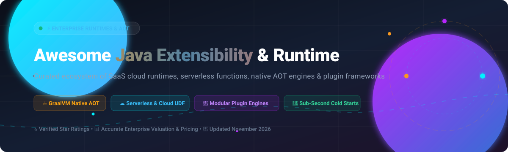

<div align="center">



# 🚀 Awesome Java Extensibility & Runtime

<a href="https://github.com/ishandutta2007/Awesome-Awesome-Awesome"></a><a href="https://discord.gg/jc4xtF58Ve"></a>
[](https://awesome.re)
[](https://opensource.org/licenses/MIT)
[](https://github.com/ishandutta2007/Awesome-Java-Extensibility-Runtime/graphs/commit-activity)
[](http://makeapullrequest.com)
<a href="https://github.com/ishandutta2007"></a>

**Curated directory of enterprise SaaS cloud execution platforms, serverless function runtimes, Ahead-Of-Time (AOT) native compilation engines, and open-source JVM modular extensibility frameworks.**

*Discover battle-tested technologies to run Java User-Defined Functions (UDFs), sub-millisecond serverless handlers, high-throughput microservices, and dynamic modular plugin systems.*

[Sector Overview](#-sector-overview--market-dynamics) • [SaaS & Cloud Platforms](#-saas--cloud-hosted-runtimes) • [Open-Source Ecosystem](#-open-source-github-projects) • [Contributing](#-how-to-contribute)

</div>

---

## 📑 Table of Contents

- [📊 Sector Overview & Market Dynamics](#-sector-overview--market-dynamics)
- [☁️ SaaS & Cloud Hosted Runtimes](#-saas--cloud-hosted-runtimes)
  - [Enterprise SaaS Comparison Matrix](#-enterprise-saas-comparison-matrix)
- [🐙 Open-Source GitHub Projects](#-open-source-github-projects)
  - [Full-Stack & Cloud-Native Frameworks](#-cloud-native-frameworks--aot-compilers)
  - [RPC, Service Mesh & Extensibility Frameworks](#-distributed-rpc--service-mesh-frameworks)
  - [Reactive & High-Throughput Runtimes](#-reactive--event-driven-runtimes)
  - [Dynamic Plugin & Extensibility Frameworks](#-dynamic-plugin-frameworks--microkernel-engines)
  - [Serverless SDKs & Cloud Function Adapters](#-serverless-function-sdks--adapters)
- [🎯 Architectural Selection Guide](#-architectural-selection-guide)
- [💖 Support & Community](#-support--community)
- [🌟 Star History](#-star-history)
- [🤝 How to Contribute](#-how-to-contribute)
- [⚖️ Disclaimer & Compliance](#-disclaimer--compliance)

---

## 📊 Sector Overview & Market Dynamics

The global enterprise application runtime, serverless compute, and cloud platform market represents an estimated **$120B+ market size** (with the dedicated serverless and cloud-native Java runtime segment expanding at a **~23% CAGR**). 

The industry demonstrates a **moderately to highly concentrated (oligopolistic) dynamic** at the infrastructure and hosted runtime tier, where hyperscalers (Microsoft Azure, Amazon AWS, Google Cloud, and Snowflake) command majority market share and capture outsized recurring cloud spend through managed execution primitives and enterprise commitments. Conversely, the **framework, compiler, and extensibility tier remains moderately fragmented and highly collaborative**: enterprises avoid single-vendor lock-in by pairing hyperscaler cloud infrastructure with open-source ecosystems (such as GraalVM Native Image, Quarkus, Spring Boot, and Apache Spark) backed by a consortium of stewards including Red Hat/IBM, Oracle, and the Apache Software Foundation.

---

## ☁️ SaaS & Cloud Hosted Runtimes

Managed enterprise cloud runtimes deliver serverless event processing, in-database SQL user-defined computations, containerized orchestration, and enterprise JDK governance without infrastructure management overhead.

### 🏢 Enterprise SaaS Comparison Matrix

*The table below ranks major commercial cloud runtime vendors sorted by enterprise valuation / market capitalization (descending).*

| Platform / Vendor | Category & Core Capability | Starting Tier Pricing | Free Tier / Trial Limit | Company Size (Valuation / Market Cap) |
| :--- | :--- | :--- | :--- | :--- |
| **[Microsoft Azure Functions Java](https://learn.microsoft.com/en-us/azure/azure-functions/functions-reference-java)** | Serverless Event-Driven Compute | **$0.20 per 1M executions** + $0.000016/GB-s (Flex Consumption) | **Free Forever**: 1,000,000 executions and 400,000 GB-seconds per month | **~$3.1 Trillion** (Market Cap) |
| **[Google Cloud Functions Java](https://cloud.google.com/functions/docs/concepts/java-runtime)** | Event-Driven Cloud Run Functions | **$0.40 per 1M invocations** + $0.0000025/GB-s (Tier 1 memory) | **Free Forever**: 2,000,000 invocations, 400,000 GB-seconds, and 200,000 GHz-seconds monthly | **~$2.1 Trillion** (Alphabet Market Cap) |
| **[AWS Lambda Java](https://docs.aws.amazon.com/lambda/latest/dg/lambda-java.html)** | Serverless Event Compute & Durable Functions | **$0.20 per 1M requests** + $0.0000166667/GB-s (x86 architecture) | **Free Forever**: 1,000,000 free requests and 400,000 GB-seconds of compute time per month | **~$2.0 Trillion** (Amazon Market Cap) |
| **[Oracle Java SE Subscription](https://www.oracle.com/java/technologies/javase-subscription.html)** | Commercial Enterprise JDK Licensing & Support | **$15.00 per employee / month** (Starting tier for 1–999 employees) | **30-day Free Trial** for Oracle Cloud Infrastructure (includes $300 cloud credits + Free Tier JDK for personal/development use) | **~$450 Billion** (Market Cap) |
| **[Red Hat OpenShift Java](https://www.redhat.com/en/technologies/cloud-computing/openshift)** | Enterprise Hybrid Cloud Kubernetes Runtime | **$0.076 per 4 vCPU-hours** (Dedicated/Cloud starting hourly rate, or $800/yr per pair) | **60-day Free Evaluation Trial** with full self-managed cluster deployment privileges | **~$190 Billion** (IBM Market Cap) |
| **[Snowflake Java UDFs](https://docs.snowflake.com/en/developer-guide/udf/java/udf-java-designing)** | Managed In-Database SQL Java User-Defined Functions | **$2.00 per credit** (Standard Edition virtual warehouse compute consumption) | **30-day Free Trial** including **$400 in free capacity credits** across supported clouds | **~$55 Billion** (Market Cap) |

---

## 🐙 Open-Source GitHub Projects

Explore top-tier, community-governed open-source tools, native compilers, serverless adapters, and modular extension frameworks for the modern JVM.

### ⚡ Cloud-Native Frameworks & AOT Compilers

*High-performance web stacks, ahead-of-time (AOT) native compilation, and microservice backbones.*

- **[Spring Boot](https://github.com/spring-projects/spring-boot)** [](https://github.com/spring-projects/spring-boot/stargazers) — The world's leading Java application framework (Apache 2.0). Features GraalVM Native Image compilation via Spring AOT, Docker Buildpacks integration, and native Spring MVC/Tomcat execution.
- **[Apache Spark](https://github.com/apache/spark)** [](https://github.com/apache/spark/stargazers) — Distributed data processing engine (Apache 2.0) with first-class Java APIs for RDDs, DataFrames, structured streaming, and scalable SQL transformations across enterprise clusters.
- **[GraalVM Compiler & Native Image](https://github.com/oracle/graal)** [](https://github.com/oracle/graal/stargazers) — Polyglot VM and Ahead-Of-Time (AOT) compiler engine compiling Java code directly into instant-on, memory-efficient native executables with zero JVM warm-up.
- **[Quarkus](https://github.com/quarkusio/quarkus)** [](https://github.com/quarkusio/quarkus/stargazers) — Supersonic Subatomic Java (Apache 2.0). Kubernetes-native stack tailored for GraalVM Native Image and HotSpot, offering sub-millisecond boot times, continuous testing, and 500+ extensions.
- **[Micronaut Core](https://github.com/micronaut-projects/micronaut-core)** [](https://github.com/micronaut-projects/micronaut-core/stargazers) — Modern, JVM-based full-stack framework designed for modular microservices and serverless functions with compile-time dependency injection and zero-reflection native binaries.

### 🌐 Distributed RPC & Service Mesh Frameworks

*Enterprise microservice communication, governance, and protocol extensibility.*

- **[Apache Dubbo](https://github.com/apache/dubbo)** [](https://github.com/apache/dubbo/stargazers) — High-performance, Java-based open-source RPC framework (Apache 2.0) providing microservice service discovery, traffic routing, intelligent load balancing, and plugin-based protocol extensibility.

### 🚀 Reactive & Event-Driven Runtimes

*Non-blocking, reactive event engines built for extreme concurrency and low memory usage.*

- **[Eclipse Vert.x](https://github.com/eclipse-vertx/vert.x)** [](https://github.com/eclipse-vertx/vert.x/stargazers) — A tool-kit for building reactive applications on the JVM (Eclipse Public License / Apache 2.0). Event-driven, non-blocking runtime handling massive throughput with negligible resource consumption.

### 🧩 Dynamic Plugin Frameworks & Microkernel Engines

*In-process modularity, runtime isolation, and dynamic plugin architectures.*

- **[PF4J (Plugin Framework for Java)](https://github.com/pf4j/pf4j)** [](https://github.com/pf4j/pf4j/stargazers) — Lightweight, robust plugin framework for Java (Apache 2.0). Enables modular architectures where plugins can be dynamically loaded, started, stopped, and uninstalled at runtime with custom classloader isolation.
- **[Apache Felix (OSGi Implementation)](https://github.com/apache/felix-dev)** [](https://github.com/apache/felix-dev/stargazers) — Community implementation of the OSGi Service Platform and Atomos modular runtime, powering enterprise microkernel architectures and modular bundle lifecycles.

### 📦 Serverless Function SDKs & Adapters

*Standardized function adapters, event schemas, and cloud provider runtime libraries.*

- **[AWS Lambda Java Libraries](https://github.com/aws/aws-lambda-java-libs)** [](https://github.com/aws/aws-lambda-java-libs/stargazers) — Official AWS Java Lambda primitives: `aws-lambda-java-core`, `aws-lambda-java-events`, and Log4j2 integration for serverless event processing.
- **[Google Cloud Functions Java Framework](https://github.com/GoogleCloudPlatform/functions-framework-java)** [](https://github.com/GoogleCloudPlatform/functions-framework-java/stargazers) — Open-source FaaS runtime framework for writing portable Java functions that run locally, on Cloud Run, or inside Knative environments.
- **[Azure Functions Java Worker](https://github.com/Azure/azure-functions-java-worker)** [](https://github.com/Azure/azure-functions-java-worker/stargazers) — Dedicated out-of-process Java language worker for the Azure Functions runtime host, handling gRPC messaging and binding dispatch.

---

## 🎯 Architectural Selection Guide

```
                                  Architecture Decision Path
                                               │
             ┌─────────────────────────────────┴─────────────────────────────────┐
             ▼                                                                   ▼
    [Managed Cloud Serverless]                                          [Self-Hosted / AOT Native]
             │                                                                   │
    ┌────────┴────────┐                                                 ┌────────┴────────┐
    ▼                 ▼                                                 ▼                 ▼
[Hyperscaler FaaS] [In-Database UDF]                            [GraalVM Native Image] [Modular In-Process]
  • AWS Lambda       • Snowflake Java UDF                         • Quarkus / Micronaut   • PF4J (Plugins)
  • Azure Functions                                               • Spring Boot AOT       • Apache Felix (OSGi)
  • Google Cloud Run
```

- **For Zero-Cold-Start Serverless Microservices**: Select **Quarkus** or **Micronaut** paired with **GraalVM Native Image**; compile ahead of time to eliminate JVM JIT warmup overhead.
- **For Enterprise SQL Data Transformation**: Leverage **Snowflake Java UDFs** or **Apache Spark Java APIs** to execute logic in close physical proximity to analytics datasets.
- **For Dynamic Desktop or Server Plugin Ecosystems**: Integrate **PF4J** for classloader-isolated extension points without full OSGi complexity.
- **For Enterprise Hybrid Deployments**: Enforce container cgroup limits (`-XX:+UseContainerSupport`) on **Red Hat OpenShift** to ensure JVM heap sizing adheres to Kubernetes pod boundaries.

---

## 💖 Support & Community

Thank you so much for exploring and supporting the **Awesome Java Extensibility & Runtime** ecosystem! 🙏

If you found this curated list helpful, here are ways you can support the project:
- ⭐ **Star this repository** to help others discover it across GitHub.
- 🍴 **Fork and contribute** by adding new cutting-edge runtimes, libraries, and benchmarks.
- 📢 **Share with colleagues and teams** building cloud-native, serverless, or native JVM services.
- ☕ **Buy a coffee & sponsor**: Support ongoing research, updates, and open-source curation on the [Sponsor Dashboard](https://github.com/sponsors/ishandutta2007).

---

## 🌟 Star History

[](https://star-history.dera.page/#ishandutta2007/Awesome-Java-Extensibility-Runtime&type=date&legend=top-left)

---

## 🤝 How to Contribute

Contributions, project suggestions, and documentation enhancements are enthusiastically welcome!

1. 🍴 **Fork the repository** to your personal GitHub account.
2. 🌿 **Create a topic branch**: `git checkout -b feature/add-new-runtime`.
3. 📝 **Edit `README.md`**: Follow existing table and list structures, providing factual pricing, GitHub star badges, and official documentation links.
4. 📬 **Submit a Pull Request** with a concise description of the addition and justification.

---

## ⚖️ Disclaimer & Compliance

- This list is independently curated by the open-source community for educational and evaluation purposes.
- All trademarks, service marks, company names, and product logos belong to their respective owners.
- Cloud pricing rates, free tier quotas, and corporate valuations represent public disclosures as of **November 2026** and are subject to change by respective cloud providers.
- Always benchmark native compilation memory overhead and test dynamic reflection configurations in staging environments before deploying native JVM binaries to mission-critical infrastructure.

---

<div align="center">

**[⬆ Back to Top](#-awesome-java-extensibility--runtime)**

</div>
